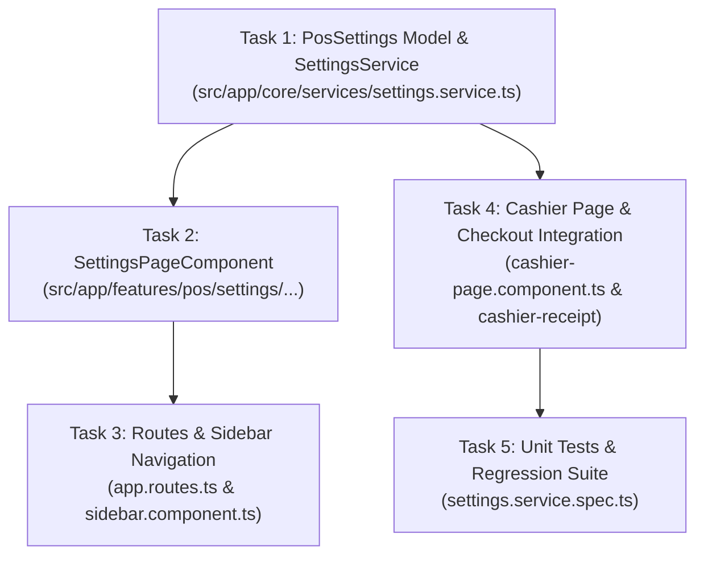

# Technical Analysis & Implementation Plan: Receipt Page Updates

**Document Version:** 2.0  
**Location:** [receipt-page-enhancements-cr-plan.md](file:///d:/Software/AL-Baraka/Pos/Cashier-web/Cashier-web-front/doc/cr/receipt-page-enhancements-cr-plan.md)  
**Status:** Ready for Implementation (Feature 1 Plan Complete; Features 2–5 Merged)  

---

## 1. Executive Summary & Change Request Matrix

This document defines the technical architecture, detailed component design, and step-by-step implementation plan for the **Receipt Page Enhancements Change Request (CR)** in the AL-Baraka POS Cashier application.

### Status of CR Items

| # | Feature / Enhancement | Scope | Status | Reference / Commit |
| :---: | :--- | :--- | :---: | :--- |
| **1** | **Remaining Amount Calculation & Configurable Threshold** | Conditionally bypass change calculation overlay for receipts $\le \text{threshold}$ (default: $50\text{ EGP}$); settings UI & reactive service. | **Implementation Plan Ready** | [Dedicated Plan Document](file:///d:/Software/AL-Baraka/Pos/Cashier-web/Cashier-web-front/doc/cr/remaining-amount-threshold-cr-plan.md) |

> [!TIP]
> The detailed, self-contained implementation plan for Update 1 is documented in:  
> &rarr; **[remaining-amount-threshold-cr-plan.md](file:///d:/Software/AL-Baraka/Pos/Cashier-web/Cashier-web-front/doc/cr/remaining-amount-threshold-cr-plan.md)**.
| **2** | **Receipt Total Appearance** | Scaled visual presentation of total due amount ($2.4\text{rem}$ bold, elevation badge). | **Completed & Merged** | Commit `493d81b` |
| **3** | **Receipt Item Separators** | High-contrast row dividers (`#cbd5e1` Slate-300) for enhanced LCD legibility. | **Completed & Merged** | Commit `493d81b` |
| **4** | **Barcode `1` Quantity Collision Fix** | Guard in `isBarcodeValue()` differentiating unedited quantity confirmation from repeat scan. | **Completed & Merged** | Commit `b4f9f53` |
| **5** | **Non-Existing Product Alert** | Inline alert beneath search field with auto-dismiss on typing and manual close button. | **Completed & Merged** | Commit `b4f9f53` |

> [!NOTE]
> Updates 2 through 5 have been fully integrated and verified in the codebase. This document details the **complete, actionable implementation plan for Feature 1 (Remaining Amount Calculation & Configurable Threshold)**.

---

## 2. Feature Specification: Remaining Amount Calculation & Configurable Threshold

### 2.1 Problem Statement & UX Motivation
In the current checkout flow:
1. Whenever the cashier triggers **Save** (`F11`) or **Save & Print** (`F12`), `CashierPageComponent.doSave()` forces the **Payment Screen Overlay** (`.payment-overlay`) to display across the top card area:
   ```typescript
   if (!this.showPaymentScreen()) {
         this.showPaymentScreen.set(true);
         return of(null);
   }
   ```
2. The cashier must enter the cash received (`المدفوع نقداً`) and press Enter to calculate change (`المتبقي (صرف)`) and finalize the receipt.
3. In retail grocery operations, low-value transactions (e.g. candy, water, small bread packs for 5–30 EGP) are almost universally paid with exact change or coins. Requiring the payment overlay for every 5 or 10 EGP sale introduces unnecessary keystrokes, slows down checkout throughput, and frustrates cashiers during peak hours.
4. For larger transactions (e.g., $> 50\text{ EGP}$), customers commonly pay with 100 or 200 EGP notes, making the change calculator indispensable for eliminating mental arithmetic errors.

### 2.2 Core Business Rules

```
                      +-----------------------------+
                      |   Cashier Clicks Save/F11   |
                      |   or Save & Print/F12       |
                      +--------------+--------------+
                                     |
                                     v
                        +-------------------------+
                        | Is Cart Empty or Stock  |
                        | Errors Present?         |
                        +------------+------------+
                                     |
                        No           |           Yes
                        +------------+------------+
                        |                         |
                        v                         v
       +----------------------------------+   Abort (No-op)
       | Payment Method == 'TRANSFER'?    |
       +----------------+-----------------+
                        |
            Yes         |         No (CASH)
            +-----------+-----------+
            |                       |
            v                       v
    Bypass Payment Screen   +------------------------------------+
    Save Receipt Directly   | Final Total > Configured Threshold?|
                            | (Default: 50.00 EGP)               |
                            +-----------------+------------------+
                                              |
                                 Yes          |          No
                                 +------------+-----------+
                                 |                        |
                                 v                        v
                    +------------------------+   Bypass Payment Screen
                    | Show Payment Overlay   |   Save Receipt Directly
                    | Cashier Enters Paid    |
                    | Press Enter to Confirm |
                    +------------------------+
```

1. **Threshold Boundary Condition:**
   - If `finalTotal <= threshold`: Bypass the payment screen overlay. The receipt saves immediately on the first click/shortcut (single-step checkout).
   - If `finalTotal > threshold`: Display the payment screen overlay. The cashier enters cash paid, verifies change, and confirms payment to save (two-step checkout).
2. **Default Value:** $50.00\text{ EGP}$.
3. **Configurability:**
   - The threshold must be configurable through a dedicated POS Settings page (`/pos/settings`).
   - If set to `0`: The payment overlay is **always displayed** for all cash receipts regardless of total.
   - Negative values are disallowed (clamped to `0`).
4. **Payment Method Awareness:**
   - If the receipt payment method is `TRANSFER` (electronic payment/transfer), cash change calculation is fundamentally irrelevant. The payment overlay is **always bypassed**, regardless of receipt total.
5. **Cashier Manual Override:**
   - If a customer gives a 200 EGP note for a 20 EGP transaction ($\le 50\text{ EGP}$), the cashier must still be able to open the payment overlay on demand.
   - A clickable shortcut / button or clicking directly on the cash payment card in the receipt workspace manually triggers `showPaymentScreen.set(true)`.
6. **Persistence & Scope:**
   - Settings are stored in `localStorage` under key `albaraka_pos_settings_v1`.
   - Each POS terminal / browser instance retains its own configured threshold without requiring a dedicated server migration.

---

## 3. Architecture & Data Design

### 3.1 Settings Model (`pos-settings.model.ts`)
Create a strongly typed interface for POS configurations, structured for future extensibility:

```typescript
export interface PosSettings {
  /** Minimum receipt total (EGP) above which the cash change payment screen is shown */
  remainingAmountThreshold: number;
  /** Whether the conditional threshold is active (if false, always show payment screen) */
  enableRemainingAmountThreshold: boolean;
  /** Timestamp of last settings update */
  lastUpdated?: string;
}

export const DEFAULT_POS_SETTINGS: PosSettings = {
  remainingAmountThreshold: 50,
  enableRemainingAmountThreshold: true,
};
```

### 3.2 Reactive State Engine (`settings.service.ts`)
The `SettingsService` provides reactive Angular Signals for synchronous component consumption:

```mermaid
flowchart LR
    LS[("localStorage\n('albaraka_pos_settings_v1')")] -->|Load & Fallback| Svc["SettingsService\n(Stateful Root Service)"]
    Svc -->|Writable Signal| St["settings: Signal<PosSettings>"]
    St -->|Computed| Th["remainingAmountThreshold: Signal<number>"]
    St -->|Computed| En["enableThreshold: Signal<boolean>"]
    
    UI["SettingsPageComponent\n(/pos/settings)"] -->|updateSettings()| Svc
    Svc -->|Persist| LS
    
    CP["CashierPageComponent\n(doSave() checkout flow)"] -->|Reads Signal| Th
```

- **Resilience & Sanitization:** If `localStorage` data is corrupted, empty, or returns `NaN`, the service gracefully falls back to `DEFAULT_POS_SETTINGS` ($50\text{ EGP}$).
- **Zero-Latency:** Signal reads are synchronous, ensuring checkout keyboard shortcuts (`F11`/`F12`) execute with zero async lag.

---

## 4. UI / UX Design Specifications

### 4.1 Settings Page (`/pos/settings`)
- **Route:** `/pos/settings` (standalone component, protected by `authGuard`).
- **Sidebar Integration:** Update [sidebar.component.ts](file:///d:/Software/AL-Baraka/Pos/Cashier-web/Cashier-web-front/src/app/shared/components/sidebar/sidebar.component.ts) line 30 from `route: '#'` to `route: '/pos/settings'`.
- **Visual Design:**
  - Standard POS page layout with right-to-left (RTL) Arabic typography (`Tajawal`).
  - Header: Icon `settings`, title `إعدادات نقطة البيع (POS Settings)`.
  - Content Card: Clean container styled with `--pos-card-bg`, subtle border `--pos-border`, and POS design tokens.
  - Controls:
    1. **تفعيل الفحص الشرطي (Enable Conditional Threshold):** Toggle switch to enable/disable the threshold. When disabled, the payment screen is always shown for all receipts.
    2. **حد إظهار شاشة المتبقي (Threshold Input):** Numeric input with step `5`, min `0`, and trailing currency badge `ج.م (EGP)`.
    3. **أزرار القيم السريعة (Preset Chips):** One-click chips for common amounts:
       - `0 ج.م (إظهار دائماً)`
       - `20 ج.م`
       - `50 ج.م (الافتراضي)`
       - `100 ج.م`
       - `200 ج.م`
    4. **شرح السلوك (Behavior Preview Card):** Dynamic helper card showing the live rule in natural Arabic:
       > *"الفواتير بقيمة **[X] ج.م أو أقل** سيتم حفظها فوراً بنقرة واحدة دون إظهار شاشة المتبقي. الفواتير **الأعلى من [X] ج.م** ستفتح شاشة حساب المتبقي تلقائياً."*
    5. **إجراءات الحفظ (Action Buttons):**
       - Primary button: `حفظ التغييرات` with icon `check` &rarr; triggers `NotificationService.success('تم حفظ الإعدادات بنجاح')`.
       - Secondary button: `استعادة الافتراضي` with icon `restart_alt` &rarr; resets threshold to `50 EGP`.
       - Navigation button: `العودة للكاشير` with icon `arrow_forward` &rarr; returns to `/pos/cashier`.

### 4.2 Cashier Workspace Integration
- **Automatic Evaluation in `doSave()`:**
  ```typescript
  const threshold = this.settingsService.remainingAmountThreshold();
  const isThresholdEnabled = this.settingsService.enableRemainingAmountThreshold();
  const paymentMethod = this.currentReceipt()?.paymentMethod || 'CASH';

  // Only CASH payments require the change calculator
  const requiresChangeScreen = paymentMethod === 'CASH' && 
                               (!isThresholdEnabled || this.finalTotal() > threshold);

  if (requiresChangeScreen && !this.showPaymentScreen()) {
        this.showPaymentScreen.set(true);
        return of(null);
  }
  ```
- **Manual Trigger Button / Shortcut:**
  In [cashier-receipt.component.html](file:///d:/Software/AL-Baraka/Pos/Cashier-web/Cashier-web-front/src/app/features/pos/cashier/components/cashier-receipt/cashier-receipt.component.html), add a small action pill or click target on the payment field:
  - Cashier clicking `حساب المتبقي` opens `.payment-overlay` even if total $\le 50\text{ EGP}$.

---

## 5. Independent Step-by-Step Implementation Tasks

Each task below is modular, self-contained, and independently verifiable.

---

### Task 1 — Core Settings Model & Reactive `SettingsService`
**Goal:** Create the POS settings data structure and an Angular `@Injectable({ providedIn: 'root' })` service providing reactive signals and local storage persistence.

**Files to Create/Modify:**
- `Cashier-web-front/src/app/core/models/pos-settings.model.ts` *(New file)*
- `Cashier-web-front/src/app/core/services/settings.service.ts` *(New file)*

**Implementation Details:**
1. In `pos-settings.model.ts`:
   - Export `PosSettings` interface:
     - `remainingAmountThreshold: number`
     - `enableRemainingAmountThreshold: boolean`
     - `lastUpdated?: string`
   - Export `DEFAULT_POS_SETTINGS`: `{ remainingAmountThreshold: 50, enableRemainingAmountThreshold: true }`.
2. In `settings.service.ts`:
   - Define storage key constant: `STORAGE_KEY = 'albaraka_pos_settings_v1'`.
   - Provide signals:
     - `private _settings = signal<PosSettings>(this.loadFromStorage())`
     - `public readonly settings = this._settings.asReadonly()`
     - `public readonly remainingAmountThreshold = computed(() => this._settings().remainingAmountThreshold)`
     - `public readonly enableRemainingAmountThreshold = computed(() => this._settings().enableRemainingAmountThreshold)`
   - Methods:
     - `updateThreshold(threshold: number): void` (validates $> 0$, clamps negative, persists to `localStorage`).
     - `setThresholdEnabled(enabled: boolean): void`.
     - `updateSettings(partial: Partial<PosSettings>): void`.
     - `resetToDefaults(): void`.
     - `loadFromStorage(): PosSettings` (with `try/catch` and sanity fallback).

**Verification Steps:**
- Run unit test / console check: Inject `SettingsService`, call `updateThreshold(75)`, reload page, verify signal retains `75`.
- Call `updateThreshold(-10)`, verify value is clamped to `0`.

---

### Task 2 — Dedicated POS Settings Page Component
**Goal:** Build the standalone `SettingsPageComponent` providing an intuitive configuration UI with preset buttons, live behavior preview, and POS design system styling.

**Files to Create:**
- `Cashier-web-front/src/app/features/pos/settings/settings-page.component.ts`
- `Cashier-web-front/src/app/features/pos/settings/settings-page.component.html`
- `Cashier-web-front/src/app/features/pos/settings/settings-page.component.css`

**Implementation Details:**
1. In `settings-page.component.ts`:
   - Standalone component importing `CommonModule`, `FormsModule`, `RouterModule`, `SidebarComponent`.
   - Inject `SettingsService`, `NotificationService`, `Router`.
   - Signals / Component state:
     - `thresholdInput = signal<number>(50)`
     - `enableThreshold = signal<boolean>(true)`
     - `sidebarVisible = signal<boolean>(false)`
     - `presets = [0, 20, 50, 100, 200]`
   - Methods:
     - `ngOnInit()`: Sync local signals with `SettingsService`.
     - `selectPreset(val: number)`: Updates `thresholdInput`.
     - `onSave()`: Saves to `SettingsService`, shows `NotificationService.success('تم حفظ إعدادات الكاشير بنجاح')`.
     - `onReset()`: Resets to default `50`, shows toast.
     - `goBack()`: Navigates to `/pos/cashier`.
2. In `settings-page.component.html`:
   - Page container matching `products-layout` / `pos-card`.
   - Embedded `<app-sidebar [expanded]="sidebarVisible()" (toggle)="sidebarVisible.update(v => !v)"></app-sidebar>`.
   - Clean Arabic form layout with preset chips and helper explanation.
3. In `settings-page.component.css`:
   - Scoped styles using `--pos-primary`, `--pos-border`, `--pos-card-bg`, `--font-family`.
   - Preset chips active state (`--pos-primary`, white text).

**Verification Steps:**
- Navigate directly to `/pos/settings`.
- Click chip `100 ج.م` &rarr; input updates to `100`.
- Click `حفظ التغييرات` &rarr; toast appears. Reload page &rarr; value remains `100`.
- Click `استعادة الافتراضي` &rarr; input resets to `50`.

---

### Task 3 — App Routing & Sidebar Navigation Integration
**Goal:** Connect the settings page into Angular Router and activate the sidebar menu link.

**Files to Modify:**
- `Cashier-web-front/src/app/app.routes.ts`
- `Cashier-web-front/src/app/shared/components/sidebar/sidebar.component.ts`

**Implementation Details:**
1. In `app.routes.ts`:
   - Add route entry:
     ```typescript
     {
       path: 'pos/settings',
       loadComponent: () => import('./features/pos/settings/settings-page.component')
                             .then(c => c.SettingsPageComponent),
       canActivate: [authGuard]
     }
     ```
2. In `sidebar.component.ts`:
   - In `navItems` array (line 30), change:
     ```typescript
     // Before:
     { label: 'الإعدادات', icon: 'settings', route: '#' }
     // After:
     { label: 'الإعدادات', icon: 'settings', route: '/pos/settings' }
     ```

**Verification Steps:**
- Open POS sidebar from cashier or products page.
- Click `الإعدادات` &rarr; URL navigates to `/pos/settings` with active sidebar highlight.
- Click `الكاشير` &rarr; URL returns to `/pos/cashier`.

---

### Task 4 — Cashier Page Checkout Flow Integration
**Goal:** Update `CashierPageComponent.doSave()` to conditionally bypass or trigger `showPaymentScreen` based on `finalTotal` vs `remainingAmountThreshold`. Provide manual override capability.

**Files to Modify:**
- `Cashier-web-front/src/app/features/pos/cashier/cashier-page.component.ts`
- `Cashier-web-front/src/app/features/pos/cashier/components/cashier-receipt/cashier-receipt.component.html` & `.ts`

**Implementation Details:**
1. In `cashier-page.component.ts`:
   - Inject `SettingsService`:
     ```typescript
     private settingsService = inject(SettingsService);
     ```
   - Update `doSave()` (lines 153–157):
     ```typescript
     const receiptData = this.currentReceipt();
     const paymentMethod = receiptData?.paymentMethod || 'CASH';
     const total = this.finalTotal();
     const threshold = this.settingsService.remainingAmountThreshold();
     const isThresholdActive = this.settingsService.enableRemainingAmountThreshold();

     // Determine if change calculation overlay is strictly required:
     // - Not required if payment method is TRANSFER
     // - Not required if threshold is active and total <= threshold
     // - Required if payment is CASH and (threshold inactive OR total > threshold)
     const requiresPaymentOverlay = paymentMethod === 'CASH' && 
                                    (!isThresholdActive || total > threshold);

     if (requiresPaymentOverlay && !this.showPaymentScreen()) {
           this.showPaymentScreen.set(true);
           return of(null);
     }
     ```
   - Add manual open handler in `CashierPageComponent`:
     ```typescript
     onOpenPaymentScreenManual(): void {
           this.showPaymentScreen.set(true);
     }
     ```
2. In `cashier-receipt.component.html` & `.ts`:
   - Add output `@Output() openPaymentScreen = new EventEmitter<void>();`.
   - In the receipt cards area, add an explicit click target or quick icon button on the payment method field:
     ```html
     <button type="button" class="btn-open-payment" (click)="openPaymentScreen.emit()" title="فتح شاشة حساب المتبقي">
           <span class="material-icons-outlined">payments</span>
     </button>
     ```
   - Wire event in `cashier-page.component.html`: `(openPaymentScreen)="onOpenPaymentScreenManual()"`.

**Verification Steps:**
- Set threshold to `50 EGP`.
- Create cart totaling `35 EGP` (`<= 50`). Press `F11` (Save) &rarr; Receipt saves immediately with **zero payment overlay popup**.
- Create cart totaling `120 EGP` (`> 50`). Press `F11` (Save) &rarr; Payment overlay **opens automatically**, input paid amount, press Enter &rarr; Receipt saves.
- Create cart totaling `25 EGP` (`<= 50`). Click manual `payments` button &rarr; Payment overlay opens on demand.
- Select payment method `TRANSFER`, cart totaling `300 EGP`. Press `F11` &rarr; Saves directly without change overlay.

---

### Task 5 — Unit Tests & Edge Case Test Suite
**Goal:** Add comprehensive automated unit tests covering default values, signal updates, boundary thresholds, negative values, and checkout bypass logic.

**Files to Create/Modify:**
- `Cashier-web-front/src/app/core/services/settings.service.spec.ts` *(New file)*
- `Cashier-web-front/src/app/features/pos/cashier/cashier-page.component.spec.ts` *(Update tests)*

**Implementation Details:**
1. In `settings.service.spec.ts`:
   - Test 1: Should initialize with default threshold of `50`.
   - Test 2: Should update threshold and persist to `localStorage`.
   - Test 3: Should clamp negative numbers to `0`.
   - Test 4: Should gracefully handle corrupt JSON or `NaN` in `localStorage` by falling back to default.
   - Test 5: Should reset to defaults on `resetToDefaults()`.
2. In `cashier-page.component.spec.ts`:
   - Test 1: Given cart total = 49.99 EGP and threshold = 50 EGP, `doSave()` should NOT open payment screen and should call save API.
   - Test 2: Given cart total = 50.00 EGP and threshold = 50 EGP, `doSave()` should NOT open payment screen (boundary inclusive).
   - Test 3: Given cart total = 50.01 EGP and threshold = 50 EGP, `doSave()` SHOULD open payment screen and return `of(null)`.
   - Test 4: Given payment method = TRANSFER and cart total = 500 EGP, `doSave()` should bypass payment screen.

**Verification Steps:**
- Run `npm test` or Angular CLI test runner &rarr; verify all tests pass with zero regressions.

---

## 6. Implementation Dependency Graph & Sequence

The implementation must proceed in the following ordered sequence:



---

## 7. QA Acceptance Criteria & Verification Matrix

| # | Test Scenario | Cart Total | Threshold Setting | Payment Method | Action | Expected Result |
| :---: | :--- | :---: | :---: | :---: | :---: | :--- |
| **TC-01** | Sub-threshold Cash Sale | 25.00 EGP | 50.00 EGP | CASH | Press `F11` (Save) | Receipt saves immediately; payment overlay **never shown**; success toast appears. |
| **TC-02** | Exact Boundary Cash Sale | 50.00 EGP | 50.00 EGP | CASH | Press `F12` (Save & Print) | Receipt saves and prints immediately ($\le$ threshold); payment overlay **bypassed**. |
| **TC-03** | Super-threshold Cash Sale | 50.50 EGP | 50.00 EGP | CASH | Press `F11` (Save) | Payment overlay **opens automatically**; focuses paid amount input. |
| **TC-04** | Super-threshold Cash Confirmation | 120.00 EGP | 50.00 EGP | CASH | Enter `200` &rarr; Enter | Change displays `80.00 EGP`; receipt saves and completes. |
| **TC-05** | High Total Electronic Transfer | 1,500.00 EGP | 50.00 EGP | TRANSFER | Click `حفظ` | Payment overlay **bypassed** (electronic transfer has no cash change); saves immediately. |
| **TC-06** | Manual Override on Small Total | 15.00 EGP | 50.00 EGP | CASH | Click `حساب المتبقي` | Payment overlay opens on demand; cashier can calculate change for large note. |
| **TC-07** | Always-Show Mode (Threshold = 0) | 10.00 EGP | 0.00 EGP | CASH | Press `F11` | Payment overlay **opens** because total ($10$) $>$ threshold ($0$). |
| **TC-08** | Threshold Modification in Settings | 80.00 EGP | Changed to 100.00 EGP | CASH | Press `F11` | Receipt saves directly because $80 \le 100\text{ EGP}$. |
| **TC-09** | Reset to Defaults in Settings | — | Click `استعادة الافتراضي` | — | Click Reset | Threshold resets to `50.00 EGP`; toast confirms reset. |
| **TC-10** | Storage Recovery on Corrupt Data | — | Set invalid JSON in storage | — | Reload page | System falls back to `50.00 EGP` without crashing or throwing unhandled exception. |

---

## 8. Record of Previously Completed Enhancements (Updates 2–5)

For architectural completeness, the technical analysis and resolution records of the other four receipt enhancements are preserved below:

### 8.1 Update 2: Receipt Total Appearance (Completed)
- **Problem:** Final total in `.amount-due` lacked visual emphasis on large monitors.
- **Resolution:** Updated [cashier-page.component.css](file:///d:/Software/AL-Baraka/Pos/Cashier-web/Cashier-web-front/src/app/features/pos/cashier/cashier-page.component.css) and [cashier-actions.component.html](file:///d:/Software/AL-Baraka/Pos/Cashier-web/Cashier-web-front/src/app/features/pos/cashier/components/cashier-actions/cashier-actions.component.html) to scale amount display to `2.4rem`, `font-weight: 900`, with proportional currency and metric badges.
- **Commit:** `493d81b`.

### 8.2 Update 3: Receipt Item Separators (Completed)
- **Problem:** Low-contrast table row border (`#e5e7eb`) caused line items to blend together on POS LCD panels.
- **Resolution:** Replaced row separators with `#cbd5e1` (Slate-300), improving the visual contrast ratio to ~2.5:1.
- **Commit:** `493d81b`.

### 8.3 Update 4: Barcode `1` Bug Resolution (Completed)
- **Problem:** In [cashier-receipt.component.ts](file:///d:/Software/AL-Baraka/Pos/Cashier-web/Cashier-web-front/src/app/features/pos/cashier/components/cashier-receipt/cashier-receipt.component.ts), pressing Enter in quantity input with value `"1"` collided with `isBarcodeValue()`, erroneously triggering a second product scan and incrementing quantity to `2`.
- **Resolution:** Added guard in `isBarcodeValue`:
  ```typescript
  if (trimmed === String(currentItem.quantity)) {
        return false;
  }
  ```
- **Commit:** `b4f9f53`.

### 8.4 Update 5: Non-Existing Product Alert (Completed)
- **Problem:** Scanning or typing an unregistered barcode provided zero user feedback.
- **Resolution:** Added `barcodeNotFound = signal<string | null>(null)` in [cashier-receipt.component.ts](file:///d:/Software/AL-Baraka/Pos/Cashier-web/Cashier-web-front/src/app/features/pos/cashier/components/cashier-receipt/cashier-receipt.component.ts) and inline alert banner in [cashier-receipt.component.html](file:///d:/Software/AL-Baraka/Pos/Cashier-web/Cashier-web-front/src/app/features/pos/cashier/components/cashier-receipt/cashier-receipt.component.html), auto-clearing upon new keystrokes.
- **Commit:** `b4f9f53`.

---
*End of Implementation Plan Document.*
