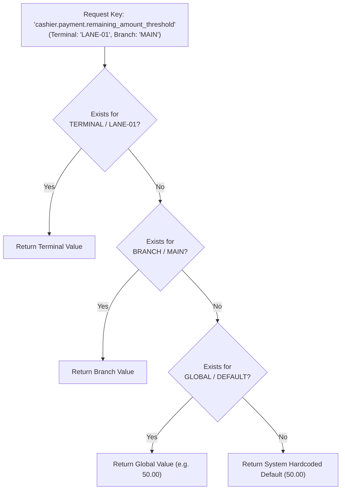

# Refactored Implementation Plan: Generic Key-Value POS Configuration System & Remaining Amount Threshold

**Document Version:** 3.0 (Generic Key-Value Configuration Pattern)  
**Location:** [remaining-amount-threshold-cr-plan.md](file:///d:/Software/AL-Baraka/Pos/Cashier-web/Cashier-web-front/doc/cr/remaining-amount-threshold-cr-plan.md)  
**Parent Change Request:** [receipt-page-enhancements-cr-plan.md](file:///d:/Software/AL-Baraka/Pos/Cashier-web/Cashier-web-front/doc/cr/receipt-page-enhancements-cr-plan.md)  
**Status:** Under Review (Ready for Approval)  

---

## 1. Executive Summary & Design Rationale

### 1.1 Objective
Establish an extensible, enterprise-grade **Key-Value POS Configuration Engine** persisted in PostgreSQL. The Remaining Amount Threshold is implemented as the inaugural configuration managed under this generic engine, avoiding one-off table columns and ensuring that all future POS settings (e.g. receipt auto-printing, tax rates, barcode scanner prefixes, discount limits) can be introduced with **zero database migrations**.

### 1.2 Why the Key-Value Pattern?
- **Infinite Schema Extensibility:** Adding a new POS setting in the future requires only inserting a new key-value row—never altering existing tables or running DDL migrations in production.
- **Hierarchical Scoping (`GLOBAL`, `BRANCH`, `TERMINAL`):** Settings can be defined store-wide as a baseline, and overridden for specific branches or physical cashier workstations (e.g. Lane 1 vs Lane 2).
- **Type-Safety & Validation:** Each configuration entry defines a `data_type` (`DECIMAL`, `BOOLEAN`, `INTEGER`, `STRING`, `JSON`), allowing backend and frontend validation before persistence.
- **Zero Checkout Latency:** The Angular frontend maintains an in-memory reactive Signal dictionary backed by a local offline cache (`localStorage['pos_settings_cache']`). Receipt calculations execute in $0\text{ ms}$ with zero network round-trips.

---

## 2. Generic Database Schema Design (`pos_settings`)

### 2.1 Table Definition DDL

```sql
-- DDL: Generic Key-Value POS Configuration Table
CREATE TABLE IF NOT EXISTS pos_settings (
    id BIGSERIAL PRIMARY KEY,
    scope_type VARCHAR(50) NOT NULL DEFAULT 'GLOBAL',
    scope_id VARCHAR(100) NOT NULL DEFAULT 'DEFAULT',
    config_key VARCHAR(100) NOT NULL,
    config_value TEXT NOT NULL,
    data_type VARCHAR(20) NOT NULL DEFAULT 'STRING',
    description VARCHAR(255),
    created_at TIMESTAMP WITHOUT TIME ZONE NOT NULL DEFAULT NOW(),
    updated_at TIMESTAMP WITHOUT TIME ZONE NOT NULL DEFAULT NOW(),
    updated_by VARCHAR(100),
    version BIGINT NOT NULL DEFAULT 0,

    CONSTRAINT uk_pos_settings_scope_key UNIQUE (scope_type, scope_id, config_key)
);

-- Index for high-performance scoped key lookups
CREATE INDEX IF NOT EXISTS idx_pos_settings_lookup 
ON pos_settings (scope_type, scope_id, config_key);

-- Seed Data: Initial Remaining Amount Configuration
INSERT INTO pos_settings (scope_type, scope_id, config_key, config_value, data_type, description, updated_by)
VALUES 
    ('GLOBAL', 'DEFAULT', 'cashier.payment.remaining_amount_threshold', '50.00', 'DECIMAL', 'الحد الأدنى لقيمة الفاتورة لإظهار شاشة حساب المتبقي (صرف)', 'SYSTEM_INIT'),
    ('GLOBAL', 'DEFAULT', 'cashier.payment.enable_remaining_amount_threshold', 'true', 'BOOLEAN', 'تفعيل الفحص الشرطي لشاشة المتبقي بناءً على الحد المالي', 'SYSTEM_INIT')
ON CONFLICT (scope_type, scope_id, config_key) DO NOTHING;
```

### 2.2 Column Specifications

| Column | Type | Nullable | Default | Description |
| :--- | :--- | :---: | :---: | :--- |
| `id` | `BIGSERIAL` | No | Auto | Surrogate primary key. |
| `scope_type` | `VARCHAR(50)` | No | `'GLOBAL'` | Target scope: `'GLOBAL'`, `'BRANCH'`, or `'TERMINAL'`. |
| `scope_id` | `VARCHAR(100)` | No | `'DEFAULT'` | Scope identifier (e.g. `'DEFAULT'`, branch code, terminal workstation ID). |
| `config_key` | `VARCHAR(100)` | No | — | Dot-notated configuration identifier (e.g. `'cashier.payment.remaining_amount_threshold'`). |
| `config_value` | `TEXT` | No | — | Serialized configuration value as string (e.g. `'50.00'`, `'true'`). |
| `data_type` | `VARCHAR(20)` | No | `'STRING'` | Value type: `'DECIMAL'`, `'BOOLEAN'`, `'INTEGER'`, `'STRING'`, `'JSON'`. |
| `description` | `VARCHAR(255)` | Yes | `NULL` | Human-readable Arabic/English description for administrators. |
| `created_at` | `TIMESTAMP` | No | `NOW()` | Record creation timestamp. |
| `updated_at` | `TIMESTAMP` | No | `NOW()` | Last modification timestamp. |
| `updated_by` | `VARCHAR(100)` | Yes | `NULL` | Username of the cashier/admin who performed the update. |
| `version` | `BIGINT` | No | `0` | Optimistic locking token (`@Version`) preventing concurrent overwrite collisions. |

---

## 3. Configuration Hierarchy & Resolution Cascade

When resolving a setting key (e.g. `cashier.payment.remaining_amount_threshold`), the system cascades through scopes until a value is found:



For Phase 1, the store manages settings under `GLOBAL / DEFAULT`. Any future branch or lane override will automatically take precedence without modifying application logic.

---

## 4. Backend Architecture (`Cashier-web-back`)

### 4.1 JPA Entity (`PosSetting.java`)
Location: `src/main/java/com/mgh/backend/cashier/entity/PosSetting.java`

```java
package com.mgh.backend.cashier.entity;

import jakarta.persistence.*;
import lombok.*;
import org.hibernate.annotations.CreationTimestamp;
import org.hibernate.annotations.UpdateTimestamp;

import java.time.LocalDateTime;

@Entity
@Table(
    name = "pos_settings",
    uniqueConstraints = {
        @UniqueConstraint(name = "uk_pos_settings_scope_key", columnNames = {"scope_type", "scope_id", "config_key"})
    },
    indexes = {
        @Index(name = "idx_pos_settings_lookup", columnList = "scope_type, scope_id, config_key")
    }
)
@Getter
@Setter
@Builder
@NoArgsConstructor
@AllArgsConstructor
public class PosSetting {

    @Id
    @GeneratedValue(strategy = GenerationType.IDENTITY)
    private Long id;

    @Column(name = "scope_type", nullable = false, length = 50)
    @Builder.Default
    private String scopeType = "GLOBAL";

    @Column(name = "scope_id", nullable = false, length = 100)
    @Builder.Default
    private String scopeId = "DEFAULT";

    @Column(name = "config_key", nullable = false, length = 100)
    private String configKey;

    @Column(name = "config_value", nullable = false, columnDefinition = "TEXT")
    private String configValue;

    @Column(name = "data_type", nullable = false, length = 20)
    @Builder.Default
    private String dataType = "STRING";

    @Column(name = "description", length = 255)
    private String description;

    @CreationTimestamp
    @Column(name = "created_at", nullable = false, updatable = false)
    private LocalDateTime createdAt;

    @UpdateTimestamp
    @Column(name = "updated_at", nullable = false)
    private LocalDateTime updatedAt;

    @Column(name = "updated_by", length = 100)
    private String updatedBy;

    @Version
    @Column(nullable = false)
    private Long version;
}
```

### 4.2 Spring Data Repository (`PosSettingsRepository.java`)
Location: `src/main/java/com/mgh/backend/cashier/repository/PosSettingsRepository.java`

```java
package com.mgh.backend.cashier.repository;

import com.mgh.backend.cashier.entity.PosSetting;
import org.springframework.data.jpa.repository.JpaRepository;
import org.springframework.stereotype.Repository;

import java.util.List;
import java.util.Optional;

@Repository
public interface PosSettingsRepository extends JpaRepository<PosSetting, Long> {

    Optional<PosSetting> findByScopeTypeAndScopeIdAndConfigKey(String scopeType, String scopeId, String configKey);

    List<PosSetting> findByScopeTypeAndScopeId(String scopeType, String scopeId);

    boolean existsByScopeTypeAndScopeIdAndConfigKey(String scopeType, String scopeId, String configKey);
}
```

### 4.3 DTOs Specification
Location: `src/main/java/com/mgh/backend/cashier/dto/`

```java
// PosSettingItemDto.java
package com.mgh.backend.cashier.dto;

import lombok.*;
import java.time.LocalDateTime;

@Getter
@Setter
@Builder
@NoArgsConstructor
@AllArgsConstructor
public class PosSettingItemDto {
    private String configKey;
    private String configValue;
    private String dataType;
    private String description;
    private LocalDateTime updatedAt;
    private String updatedBy;
}
```

```java
// PosSettingsResponseDto.java (Map-based for easy client consumption)
package com.mgh.backend.cashier.dto;

import lombok.*;
import java.util.Map;

@Getter
@Setter
@Builder
@NoArgsConstructor
@AllArgsConstructor
public class PosSettingsResponseDto {
    private String scopeType;
    private String scopeId;
    /** Map of configKey -> configValue */
    private Map<String, String> settings;
    /** Optional detailed metadata per setting */
    private Map<String, PosSettingItemDto> details;
}
```

```java
// UpdatePosSettingsBatchRequestDto.java
package com.mgh.backend.cashier.dto;

import jakarta.validation.constraints.NotEmpty;
import lombok.*;
import java.util.Map;

@Getter
@Setter
@Builder
@NoArgsConstructor
@AllArgsConstructor
public class UpdatePosSettingsBatchRequestDto {

    private String scopeType; // defaults to "GLOBAL"
    private String scopeId;   // defaults to "DEFAULT"

    @NotEmpty(message = "يجب تحديد إعداد واحد على الأقل للتحديث")
    private Map<String, String> settings;
}
```

### 4.4 Service Layer (`PosSettingsService.java`)
Location: `src/main/java/com/mgh/backend/cashier/service/PosSettingsService.java`

**Core Service Methods:**
1. **`getEffectiveSettings(String scopeType, String scopeId)`**:
   - Queries `pos_settings` for the given scope (falls back to `GLOBAL/DEFAULT`).
   - Ensures standard keys exist; auto-seeds default entries if missing.
   - Returns `PosSettingsResponseDto` with both flattened `Map<String, String>` and typed details.
2. **`getValue(String key, String defaultValue)`**:
   - Generic resolver for internal backend services needing configuration lookups.
3. **`getDecimal(String key, BigDecimal defaultValue)`**:
   - Parses decimal values with validation; fallback on parse failure.
4. **`getBoolean(String key, boolean defaultValue)`**:
   - Parses boolean strings (`"true"`, `"false"`).
5. **`updateSettingsBatch(UpdatePosSettingsBatchRequestDto request, String currentUsername)`**:
   - Validates each setting value against its declared `data_type` (e.g. validates `remaining_amount_threshold` is a non-negative decimal).
   - Updates existing records or inserts new keys.
   - Audits `updatedBy` and timestamps.
6. **`resetKeysToDefaults(List<String> keys, String scopeType, String scopeId, String currentUsername)`**:
   - Resets specified keys (or all keys) to factory defaults.

### 4.5 REST Controller (`PosSettingsController.java`)
Location: `src/main/java/com/mgh/backend/cashier/controller/PosSettingsController.java`

```java
package com.mgh.backend.cashier.controller;

import com.mgh.backend.cashier.dto.PosSettingsResponseDto;
import com.mgh.backend.cashier.dto.UpdatePosSettingsBatchRequestDto;
import com.mgh.backend.cashier.service.PosSettingsService;
import jakarta.validation.Valid;
import lombok.RequiredArgsConstructor;
import org.springframework.http.ResponseEntity;
import org.springframework.security.core.Authentication;
import org.springframework.web.bind.annotation.*;

import java.util.List;

@RestController
@RequestMapping("/api/pos/settings")
@RequiredArgsConstructor
public class PosSettingsController {

    private final PosSettingsService posSettingsService;

    @GetMapping
    public ResponseEntity<PosSettingsResponseDto> getSettings(
            @RequestParam(defaultValue = "GLOBAL") String scopeType,
            @RequestParam(defaultValue = "DEFAULT") String scopeId
    ) {
        return ResponseEntity.ok(posSettingsService.getEffectiveSettings(scopeType, scopeId));
    }

    @PutMapping
    public ResponseEntity<PosSettingsResponseDto> updateSettings(
            @Valid @RequestBody UpdatePosSettingsBatchRequestDto request,
            Authentication authentication
    ) {
        String username = authentication != null ? authentication.getName() : "ANONYMOUS";
        return ResponseEntity.ok(posSettingsService.updateSettingsBatch(request, username));
    }

    @PostMapping("/reset")
    public ResponseEntity<PosSettingsResponseDto> resetToDefaults(
            @RequestParam(defaultValue = "GLOBAL") String scopeType,
            @RequestParam(defaultValue = "DEFAULT") String scopeId,
            @RequestBody(required = false) List<String> keys,
            Authentication authentication
    ) {
        String username = authentication != null ? authentication.getName() : "ANONYMOUS";
        return ResponseEntity.ok(posSettingsService.resetKeysToDefaults(keys, scopeType, scopeId, username));
    }
}
```

---

## 5. Frontend Layer Design (`Cashier-web-front`)

### 5.1 Architecture: Server-First Key-Value Signals with Offline Caching

```mermaid
flowchart TD
    subgraph UI["Angular Frontend"]
        CP["CashierPageComponent\n(Checkout: doSave())"]
        SP["SettingsPageComponent\n(/pos/settings)"]
        SVC["SettingsService\n(Injectable Root Service)"]
        SIG["Signals:\n- settingsMap: Signal<Record<string, string>>\n- remainingAmountThreshold: Signal<number>\n- enableRemainingAmountThreshold: Signal<boolean>"]
    end

    subgraph Storage["Storage & Backend"]
        CACHE[("localStorage\n('pos_settings_cache')\n[Offline Replica]")]
        API["Backend REST API\n(/api/pos/settings)"]
        DB[("PostgreSQL: pos_settings\n[SOURCE OF TRUTH]")]
    end

    %% Read
    SVC -->|1. GET /api/pos/settings| API
    API -->|Fetch Key-Value Rows| DB
    API -->|200 OK Response| SVC
    SVC -->|Update Signal| SIG
    SVC -->|Write-through Cache| CACHE
    CP -->|Synchronous Signal Read (0ms)| SIG

    %% Offline Fallback
    API -.->|Network Disconnect| SVC
    CACHE -.->|Fallback Read| SVC

    %% Write
    SP -->|Save Button| SVC
    SVC -->|PUT /api/pos/settings\n(Batch Key-Value Map)| API
    API -->|Update DB Rows| DB
```

### 5.2 Key Constants & Model Contract (`pos-settings.model.ts`)
Location: `src/app/core/models/pos-settings.model.ts`

```typescript
/** Canonical dot-notated configuration keys */
export const POS_CONFIG_KEYS = {
  REMAINING_AMOUNT_THRESHOLD: 'cashier.payment.remaining_amount_threshold',
  ENABLE_REMAINING_AMOUNT_THRESHOLD: 'cashier.payment.enable_remaining_amount_threshold',
} as const;

/** System fallback defaults when neither server nor cache is reachable */
export const DEFAULT_CONFIG_VALUES: Record<string, string> = {
  [POS_CONFIG_KEYS.REMAINING_AMOUNT_THRESHOLD]: '50.00',
  [POS_CONFIG_KEYS.ENABLE_REMAINING_AMOUNT_THRESHOLD]: 'true',
};

export interface PosSettingItem {
  configKey: string;
  configValue: string;
  dataType: 'STRING' | 'DECIMAL' | 'BOOLEAN' | 'INTEGER' | 'JSON';
  description?: string;
  updatedAt?: string;
  updatedBy?: string;
}

export interface PosSettingsResponse {
  scopeType: string;
  scopeId: string;
  settings: Record<string, string>;
  details?: Record<string, PosSettingItem>;
}

export interface UpdatePosSettingsBatchRequest {
  scopeType?: string;
  scopeId?: string;
  settings: Record<string, string>;
}
```

### 5.3 Refactored `SettingsService` (`settings.service.ts`)
Location: `src/app/core/services/settings.service.ts`

```typescript
import { Injectable, inject, signal, computed } from '@angular/core';
import { HttpClient } from '@angular/common/http';
import { Observable, of, tap, catchError } from 'rxjs';
import { environment } from '../../../../../environments/environment';
import { 
  POS_CONFIG_KEYS, 
  DEFAULT_CONFIG_VALUES, 
  PosSettingsResponse, 
  UpdatePosSettingsBatchRequest 
} from '../models/pos-settings.model';

@Injectable({
  providedIn: 'root'
})
export class SettingsService {
  private http = inject(HttpClient);
  private readonly apiUrl = `${environment.apiUrl}/pos/settings`;
  private readonly CACHE_KEY = 'pos_settings_cache';

  // Internal reactive dictionary of all key-value settings
  private _settingsMap = signal<Record<string, string>>(this.loadInitialCache());
  public readonly settingsMap = this._settingsMap.asReadonly();

  // Typed Computed Signals for Cashier & Checkout consumption
  public readonly remainingAmountThreshold = computed(() => {
    const raw = this._settingsMap()[POS_CONFIG_KEYS.REMAINING_AMOUNT_THRESHOLD];
    const parsed = parseFloat(raw);
    return isNaN(parsed) || parsed < 0 ? 50.00 : parsed;
  });

  public readonly enableRemainingAmountThreshold = computed(() => {
    const raw = this._settingsMap()[POS_CONFIG_KEYS.ENABLE_REMAINING_AMOUNT_THRESHOLD];
    return raw !== undefined ? raw === 'true' : true;
  });

  private _isLoading = signal<boolean>(false);
  public readonly isLoading = this._isLoading.asReadonly();

  /** Eagerly load from backend with offline fallback */
  loadSettings(): Observable<PosSettingsResponse | null> {
    this._isLoading.set(true);
    return this.http.get<PosSettingsResponse>(this.apiUrl).pipe(
      tap(res => {
        if (res && res.settings) {
          this._settingsMap.set(res.settings);
          this.writeCache(res.settings);
        }
        this._isLoading.set(false);
      }),
      catchError(err => {
        console.warn('[SettingsService] Failed to fetch settings from server; using local cache.', err);
        this._isLoading.set(false);
        return of(null);
      })
    );
  }

  /** Generic getter for any future setting key */
  getValue(key: string, fallback: string = ''): string {
    return this._settingsMap()[key] ?? fallback;
  }

  /** Save a batch of key-value pairs to the database */
  saveSettings(updates: Record<string, string>): Observable<PosSettingsResponse> {
    this._isLoading.set(true);
    const payload: UpdatePosSettingsBatchRequest = {
      scopeType: 'GLOBAL',
      scopeId: 'DEFAULT',
      settings: updates
    };

    return this.http.put<PosSettingsResponse>(this.apiUrl, payload).pipe(
      tap(res => {
        if (res && res.settings) {
          const merged = { ...this._settingsMap(), ...res.settings };
          this._settingsMap.set(merged);
          this.writeCache(merged);
        }
        this._isLoading.set(false);
      }),
      catchError(err => {
        this._isLoading.set(false);
        throw err;
      })
    );
  }

  /** Reset settings to defaults on the database */
  resetToDefaults(keys?: string[]): Observable<PosSettingsResponse> {
    this._isLoading.set(true);
    return this.http.post<PosSettingsResponse>(`${this.apiUrl}/reset`, keys || []).pipe(
      tap(res => {
        if (res && res.settings) {
          this._settingsMap.set(res.settings);
          this.writeCache(res.settings);
        }
        this._isLoading.set(false);
      }),
      catchError(err => {
        this._isLoading.set(false);
        throw err;
      })
    );
  }

  private loadInitialCache(): Record<string, string> {
    try {
      const raw = localStorage.getItem(this.CACHE_KEY);
      if (raw) return { ...DEFAULT_CONFIG_VALUES, ...JSON.parse(raw) };
    } catch {}
    return { ...DEFAULT_CONFIG_VALUES };
  }

  private writeCache(map: Record<string, string>): void {
    try {
      localStorage.setItem(this.CACHE_KEY, JSON.stringify(map));
    } catch (e) {
      console.warn('[SettingsService] Failed to cache settings in localStorage', e);
    }
  }
}
```

### 5.4 Settings Page Component (`SettingsPageComponent`)
Location: `src/app/features/pos/settings/settings-page.component.ts`

- Uses `SettingsService.saveSettings({ [POS_CONFIG_KEYS.REMAINING_AMOUNT_THRESHOLD]: String(val), [POS_CONFIG_KEYS.ENABLE_REMAINING_AMOUNT_THRESHOLD]: String(enabled) })`.
- Displays loading spinner during server requests, success toasts via `NotificationService`, and clean Arabic error alerts if offline.
- Features preset chips (`0`, `20`, `50`, `100`, `200 EGP`) and live behavior helper text.

### 5.5 Cashier Page Integration (`CashierPageComponent.doSave()`)
The checkout logic remains clean, fast, and decoupled:
```typescript
private doSave(): Observable<ReceiptResponse | null> {
    const items = this.cartItems();
    if (items.length === 0) return of(null);
    if (this.hasStockErrors()) return of(null);

    const total = this.finalTotal();
    const threshold = this.settingsService.remainingAmountThreshold();
    const isThresholdEnabled = this.settingsService.enableRemainingAmountThreshold();
    const paymentMethod = this.currentReceipt()?.paymentMethod || 'CASH';

    // 0ms Synchronous Signal check
    const requiresPaymentOverlay = paymentMethod === 'CASH' && 
                                   (!isThresholdEnabled || total > threshold);

    if (requiresPaymentOverlay && !this.showPaymentScreen()) {
          this.showPaymentScreen.set(true);
          return of(null);
    }

    // Proceed to save receipt payload...
}
```

---

## 6. Step-by-Step Implementation Tasks

---

### Task 1 — Backend: Generic `pos_settings` Table & JPA Entity
**Goal:** Create generic key-value table and JPA entity with scope constraints.

**Files:**
- `Cashier-web-back/src/main/java/com/mgh/backend/cashier/entity/PosSetting.java`
- `Cashier-web-back/src/main/java/com/mgh/backend/cashier/repository/PosSettingsRepository.java`
- `Cashier-web-back/src/main/java/com/mgh/backend/cashier/config/CashierDataInitializer.java`

**Steps:**
1. Create `PosSetting` entity with fields: `id`, `scopeType`, `scopeId`, `configKey`, `configValue`, `dataType`, `description`, `createdAt`, `updatedAt`, `updatedBy`, `version`.
2. Add unique constraint: `uk_pos_settings_scope_key (scope_type, scope_id, config_key)`.
3. Create `PosSettingsRepository` with scope/key lookup methods.
4. In `CashierDataInitializer`, seed `cashier.payment.remaining_amount_threshold` (`'50.00'`, `'DECIMAL'`) and `cashier.payment.enable_remaining_amount_threshold` (`'true'`, `'BOOLEAN'`).

**Verification:**
- Start backend &rarr; table `pos_settings` created with 2 default configuration rows.

---

### Task 2 — Backend: Configuration Service, Validation & REST APIs
**Goal:** Implement generic DTOs, type-validation service logic, and REST endpoints.

**Files:**
- `Cashier-web-back/src/main/java/com/mgh/backend/cashier/dto/PosSettingItemDto.java`
- `Cashier-web-back/src/main/java/com/mgh/backend/cashier/dto/PosSettingsResponseDto.java`
- `Cashier-web-back/src/main/java/com/mgh/backend/cashier/dto/UpdatePosSettingsBatchRequestDto.java`
- `Cashier-web-back/src/main/java/com/mgh/backend/cashier/service/PosSettingsService.java`
- `Cashier-web-back/src/main/java/com/mgh/backend/cashier/service/impl/PosSettingsServiceImpl.java`
- `Cashier-web-back/src/main/java/com/mgh/backend/cashier/controller/PosSettingsController.java`

**Steps:**
1. Implement `PosSettingsService`:
   - `getEffectiveSettings(scopeType, scopeId)`: returns `PosSettingsResponseDto` map.
   - `updateSettingsBatch(request, username)`: validates data types (`DECIMAL` must be non-negative number, `BOOLEAN` must be true/false) and updates in transaction.
   - `resetKeysToDefaults(keys, scopeType, scopeId, username)`.
2. Implement `PosSettingsController`:
   - `GET /api/pos/settings` &rarr; `200 OK`
   - `PUT /api/pos/settings` &rarr; `200 OK`
   - `POST /api/pos/settings/reset` &rarr; `200 OK`
3. Permit authenticated access in `SecurityConfig.java`.

**Verification:**
- `GET /api/pos/settings` returns map with `cashier.payment.remaining_amount_threshold: "50.00"`.
- `PUT /api/pos/settings` with invalid decimal `"abc"` returns `400 Bad Request`.
- `PUT /api/pos/settings` with `"75.00"` returns `200 OK` and persists in PostgreSQL.

---

### Task 3 — Frontend: Generic `SettingsService` & Reactive Key-Value Signals
**Goal:** Build Angular `SettingsService` consuming the generic API and managing cached signals.

**Files:**
- `Cashier-web-front/src/app/core/models/pos-settings.model.ts`
- `Cashier-web-front/src/app/core/services/settings.service.ts`

**Steps:**
1. Define `POS_CONFIG_KEYS`, `DEFAULT_CONFIG_VALUES`, and API interfaces in `pos-settings.model.ts`.
2. Implement `SettingsService` with `_settingsMap = signal<Record<string, string>>()`, `remainingAmountThreshold = computed(...)`, and `enableRemainingAmountThreshold = computed(...)`.
3. Add `loadSettings()`, `saveSettings()`, and `resetToDefaults()`.
4. Implement local caching in `localStorage['pos_settings_cache']`.

**Verification:**
- Unit tests verify signal updates on successful API response and fallback to cache on network failure.

---

### Task 4 — Frontend: Settings UI & Navigation
**Goal:** Build `SettingsPageComponent` and wire routing and sidebar navigation.

**Files:**
- `Cashier-web-front/src/app/features/pos/settings/settings-page.component.ts`
- `Cashier-web-front/src/app/features/pos/settings/settings-page.component.html`
- `Cashier-web-front/src/app/features/pos/settings/settings-page.component.css`
- `Cashier-web-front/src/app/app.routes.ts`
- `Cashier-web-front/src/app/shared/components/sidebar/sidebar.component.ts`

**Steps:**
1. Build `SettingsPageComponent` with threshold input, master toggle, presets chips, and live preview.
2. Wire save and reset buttons to `SettingsService.saveSettings()` and `SettingsService.resetToDefaults()`.
3. Add route `/pos/settings` with `authGuard` in `app.routes.ts`.
4. Activate `sidebar.component.ts` line 30 to `route: '/pos/settings'`.

**Verification:**
- Open sidebar &rarr; click `الإعدادات` &rarr; loads settings from PostgreSQL.
- Select `100 ج.م` &rarr; click `حفظ التغييرات` &rarr; row in DB updates to `"100.00"`.

---

### Task 5 — Frontend: Cashier Checkout Integration & Manual Override
**Goal:** Connect `CashierPageComponent.doSave()` to the reactive threshold signal and provide manual change calculator trigger.

**Files:**
- `Cashier-web-front/src/app/features/pos/cashier/cashier-page.component.ts`
- `Cashier-web-front/src/app/features/pos/cashier/cashier-page.component.html`
- `Cashier-web-front/src/app/features/pos/cashier/components/cashier-receipt/cashier-receipt.component.html` & `.ts`

**Steps:**
1. In `CashierPageComponent`:
   - Call `settingsService.loadSettings()` in `ngOnInit()`.
   - Update `doSave()` to evaluate `finalTotal() > threshold` for `CASH` payments.
   - Add `onOpenPaymentScreenManual()`.
2. In `cashier-receipt.component.html`:
   - Add click trigger button next to payment method for manual override.

**Verification:**
- Cart total = $30\text{ EGP}$ ($\le 50$) &rarr; `F11` saves immediately.
- Cart total = $80\text{ EGP}$ ($> 50$) &rarr; `F11` opens payment overlay.
- Cart total = $30\text{ EGP}$, click manual button &rarr; payment overlay opens.
- Cart total = $200\text{ EGP}$, payment = `TRANSFER` &rarr; saves immediately.

---

### Task 6 — Automated Unit & Integration Testing
**Goal:** Create comprehensive test coverage across backend and frontend layers.

**Files:**
- `Cashier-web-back/src/test/java/com/mgh/backend/cashier/controller/PosSettingsControllerTest.java`
- `Cashier-web-back/src/test/java/com/mgh/backend/cashier/service/PosSettingsServiceTest.java`
- `Cashier-web-front/src/app/core/services/settings.service.spec.ts`

**Steps:**
1. Backend Tests:
   - Verify `GET /api/pos/settings` returns key-value map.
   - Verify `PUT /api/pos/settings` updates key-value pairs.
   - Verify validation rejection of invalid data types.
2. Frontend Tests:
   - Verify `SettingsService` correctly parses strings to numbers and booleans.
   - Verify offline fallback when HTTP request fails.

---

## 7. QA Acceptance Criteria & Test Matrix

| # | Test Scenario | Cart Total | Setting in DB | Payment Method | Action | Expected Result |
| :---: | :--- | :---: | :---: | :---: | :---: | :--- |
| **TC-01** | Sub-threshold Cash Sale | 25.00 EGP | `threshold = "50.00"` | CASH | Press `F11` (Save) | Saves immediately; payment overlay **never shown**; toast confirms save. |
| **TC-02** | Exact Boundary Cash Sale | 50.00 EGP | `threshold = "50.00"` | CASH | Press `F12` (Save & Print) | Saves and prints immediately ($\le$ threshold); overlay **bypassed**. |
| **TC-03** | Super-threshold Cash Sale | 50.50 EGP | `threshold = "50.00"` | CASH | Press `F11` (Save) | Payment overlay **opens automatically**; focuses paid amount input. |
| **TC-04** | Super-threshold Confirmation | 120.00 EGP | `threshold = "50.00"` | CASH | Enter `200` &rarr; Enter | Change displays `80.00 EGP`; receipt saves and completes. |
| **TC-05** | High Total Electronic Transfer | 1,500.00 EGP | `threshold = "50.00"` | TRANSFER | Click `حفظ` | Payment overlay **bypassed**; saves immediately. |
| **TC-06** | Manual Override on Small Total | 15.00 EGP | `threshold = "50.00"` | CASH | Click `payments` button | Payment overlay opens on demand; cashier can calculate change for large bill. |
| **TC-07** | Always-Show Mode (`threshold = "0"`) | 10.00 EGP | `threshold = "0.00"` | CASH | Press `F11` | Payment overlay **opens** because total ($10$) $>$ threshold ($0$). |
| **TC-08** | Batch Key Update in Settings | 80.00 EGP | Updated to `"100.00"` in DB | CASH | Press `F11` | Saves directly because $80 \le 100\text{ EGP}$. |
| **TC-09** | Reset to Defaults in Settings | — | Click `استعادة الافتراضي` | — | Click Reset | DB rows reset to `"50.00"` and `"true"`; toast confirms reset. |
| **TC-10** | Offline POS Resiliency | 30.00 EGP | Backend Disconnected | CASH | Press `F11` | Checkout functions seamlessly using `localStorage['pos_settings_cache']`. |

---

## 8. Summary of Completed Enhancements (Updates 2–5)

The other four receipt enhancements remain completed and verified in the codebase:
- **Update 2 (Receipt Total Appearance):** Scaled amount display to `2.4rem` bold with elevation card (Commit `493d81b`).
- **Update 3 (Receipt Item Separators):** Upgraded line item borders to `#cbd5e1` Slate-300 (Commit `493d81b`).
- **Update 4 (Barcode `1` Bug Resolution):** Quantity confirmation guard in `isBarcodeValue()` (Commit `b4f9f53`).
- **Update 5 (Non-Existing Product Alert):** Inline error banner beneath barcode search (Commit `b4f9f53`).

---
*End of Generic Key-Value POS Configuration Implementation Plan.*
